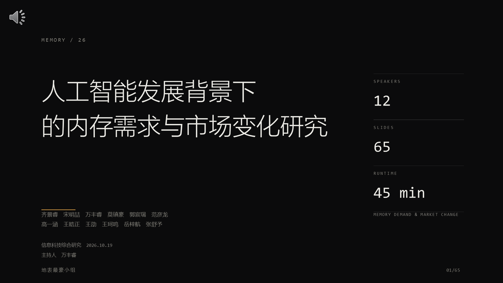
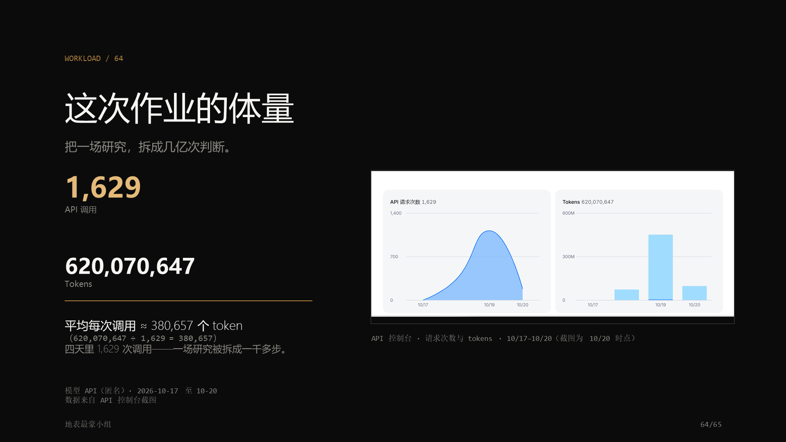

# 人工智能发展背景下的内存需求与市场变化研究

> 一个中学生小组的信息科技综合研究作业：**65 页幻灯片 + 14 页论文 + 45 分钟演讲稿**。
>
> [](https://www.gnu.org/licenses/gpl-3.0)
> 全部内容由 AI 生成，小组负责方向确认与事实核对。





---

## 这是什么

- **研究对象**：AI 应用（大语言模型、游戏、修图、推荐等）如何改变内存的需求与价格，普通消费者如何判断、如何应对。
- **形式**：12 位讲者的课堂汇报（PPT 65 页）、一篇小论文（14 页）、一份 45 分钟演讲稿（含 Q&A 预案与翻页提示）。
- **特点**：
  - 把“内存”拆成主存、显存、长期存储三类对象，避免把不同市场的数据混用；
  - 给出可复核的估算式与数量级（KV 缓存、参数显存、DRAM 份额、合约价）；
  - 区分技术事实、市场观察与政策文本，结论标注边界；
  - 结尾有一个“揭晓”设计：整份作业由 AI 完成。

## 目录结构

```
.
├── README.md
├── LICENSE                        GNU GPL v3.0 or later（第三方素材除外）
├── CITATION.cff                   引用信息
├── 第三方素材与授权.md             音乐 / 视频 / 字体 / 截图版权说明
├── 开源检查报告.md                 脱敏与敏感信息扫描结果
├── presentation/
│   ├── 研究汇报-65页.pptx          65 页，含备注、动画、内嵌视频与配乐（约 24 MB）
│   └── 研究汇报-65页.pdf           幻灯片 PDF 预览
├── paper/
│   ├── 研究报告-论文版.docx        14 页，含附录 A/B 与声明
│   └── 研究报告-论文版.pdf
├── speech/
│   ├── 研究汇报-演讲稿-45分钟版.docx  45 分钟版，附录 A–E（提词卡/时间表/Q&A/翻页笔）
│   └── 研究汇报-演讲稿-45分钟版.pdf
└── assets/                        预览图与脱敏后的控制台截图
```

**建议打开方式**：PPT 用 Microsoft PowerPoint（动画、内嵌视频与音频只在 PowerPoint 完整支持，WPS 可能不播）；论文与讲稿用 Word 或看 PDF。

## 快速开始

```bash
# 1. 克隆（把 <你的用户名> 换成实际账号）
git clone https://github.com/<你的用户名>/ai-memory-research.git
cd ai-memory-research

# 2. 直接打开文件
#    presentation/研究汇报-65页.pptx
#    paper/研究报告-论文版.pdf
#    speech/研究汇报-演讲稿-45分钟版.pdf
```

## 隐私与脱敏说明

经作者同意，本仓库**保留真实姓名、学校、邮编与作者邮箱**；同时对以下内容做了处理：

| 项目 | 处理 |
|---|---|
| 姓名 / 学校 / 邮编 / 邮箱 | **保留**（已获作者同意公开） |
| 邮箱 | **保留**（论文作者简介中的 E-mail，已获作者同意公开） |
| API 密钥 / 账号 / 接口地址 | 三份文件中**从未包含**；已扫描确认 0 命中 |
| API 控制台截图 | 第 64 页截图已裁切（去掉金额卡片与账户区域），并遮挡模型/服务商标识，仅保留请求次数与 tokens |
| 文档元数据 | 作者、最后修改者等已改为公开用的匿名信息 |

未包含手机号、微信、身份证号或家庭住址。实验室/机房等环境信息也未出现在文件中。

## AI 生成与“揭晓页”说明

- 本作业的**选题、资料检索、论文、幻灯片、动画、讲稿、配乐拼接**均由 AI 完成；小组负责方向确认与事实核对。
- 第 63 页揭晓的模型名 **DeepSeek-V4.1-Flash 1017 max** 与 **ChatGPT6 Astra ultra** 是**展示用的虚构设定**（汇报的“反转”桥段），不对应任何真实产品，请勿当作事实引用。
- 第 64 页的 API 调用量与 token 数是**截图时点**的真实使用量，用于说明“AI 完成这份作业的工作量”，不构成对任何服务的推荐。

## 数据与引用

- 技术参数：Valve（CS2 官方配置）、NVIDIA（GPU 规格）、JEDEC（内存标准）、厂商公开文档；
- 市场数据：TrendForce 等研究机构公开新闻稿（2026 年第二季度份额、2025 年 7 月 DDR4 合约价、四季度预测）；
- 政策文本：美国 BIS（2024-12-02 出口管制）、长鑫存储（2025-11 产品发布）；
- 视频案例：哔哩哔哩 BV1pv421r7Yu（第三方，仅作研究案例引用）。

论文末尾附 9 条参考文献与资料清单（附录 B）。价格与份额均为**特定时点数据**，引用时请保留日期与口径（营收 vs 出货、合约 vs 零售、预测 vs 事实）。

## 如何发布到 GitHub

本目录已经可以作为一个完整仓库上传：

```bash
cd github-repo
git init -b main
git add .
git commit -m "docs: 初始开源：65页幻灯片 + 论文 + 45分钟演讲稿"

# 在 GitHub 上新建空仓库 ai-memory-research（不要勾选 README/LICENSE），然后：
git remote add origin https://github.com/<你的用户名>/ai-memory-research.git
git push -u origin main
```

建议的仓库简介与 topics：

- Description：`中学生信息科技综合研究：AI 时代的内存需求与市场变化（65页PPT + 论文 + 45分钟演讲稿，AI 生成）`
- Topics：`ai` `memory` `dram` `hbm` `presentation` `chinese` `school-project` `ai-generated`

## 许可协议

- 本仓库的原创内容（文字、幻灯片、论文、讲稿，以及用于生成它们的脚本）采用
  **GNU General Public License v3.0 or later（GPL-3.0-or-later）** 许可，
  全文见 [`LICENSE`](LICENSE)。
- 版权声明：**Copyright (C) 2026 地表最豪小组**。
- **第三方素材不在此许可范围内**，详见 `第三方素材与授权.md`：
  - 背景音乐：Mixkit Free License（嵌入演示文稿使用；请勿单独提取再分发）；
  - 视频：B 站 UP 主 夜清月明（BV1pv421r7Yu），版权归原作者，仅作研究引用；
    公开再分发前建议将第 61 页内嵌视频改为链接引用；
  - 字体：Microsoft YaHei / Consolas（Windows 系统字体，未嵌入分发）；
  - API 控制台截图：已脱敏，仅保留数字。
- 按 GPL 要求，二次发布请保留版权声明与许可文本，并注明修改。
- 如果你更希望「非商业」限制（GPL 允许商业使用），可改用 CC BY-NC-SA 4.0；
  当前仓库发布版本为 GPL-3.0-or-later。

## 引用

```
地表最豪小组. (2026). 人工智能发展背景下的内存需求与市场变化研究 [GitHub repository].
https://github.com/<你的用户名>/ai-memory-research
```

本仓库附 `CITATION.cff`，GitHub 会自动显示「Cite this repository」按钮。

## 免责声明

- 本作业是中学信息科技综合研究的教学成果，不构成投资建议或采购建议；
- 文中预测均标注来源与时点，实际情况可能不同；
- 若发现数据或表述错误，欢迎提 Issue 指出。

## 参与

- 提 Issue：数据勘误、表述建议、二次使用问题；
- 提 PR：改进讲稿节奏、替换第三方素材、补充可复核的公开数据；
- 请勿在 Issue/PR 中提交 API 密钥、账号或联系方式。
